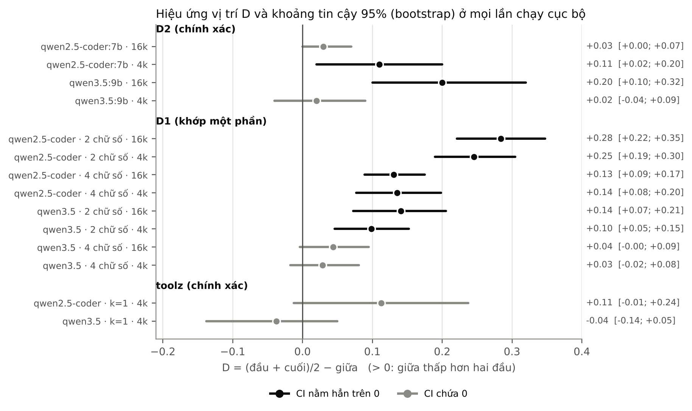
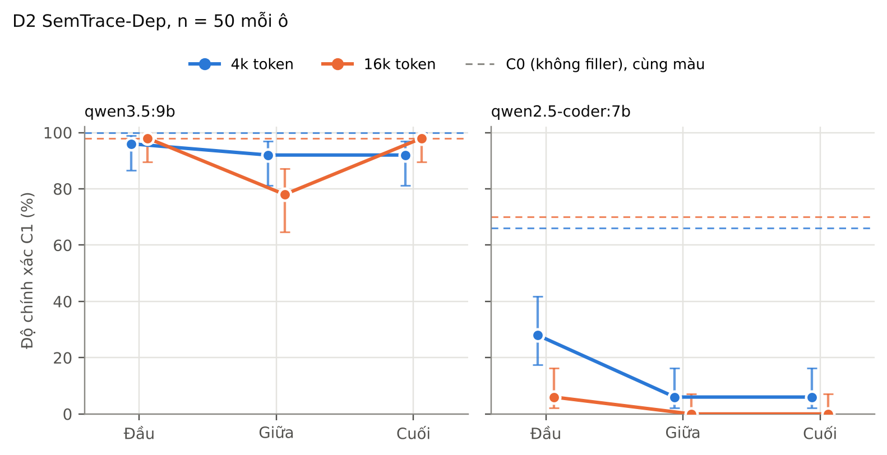
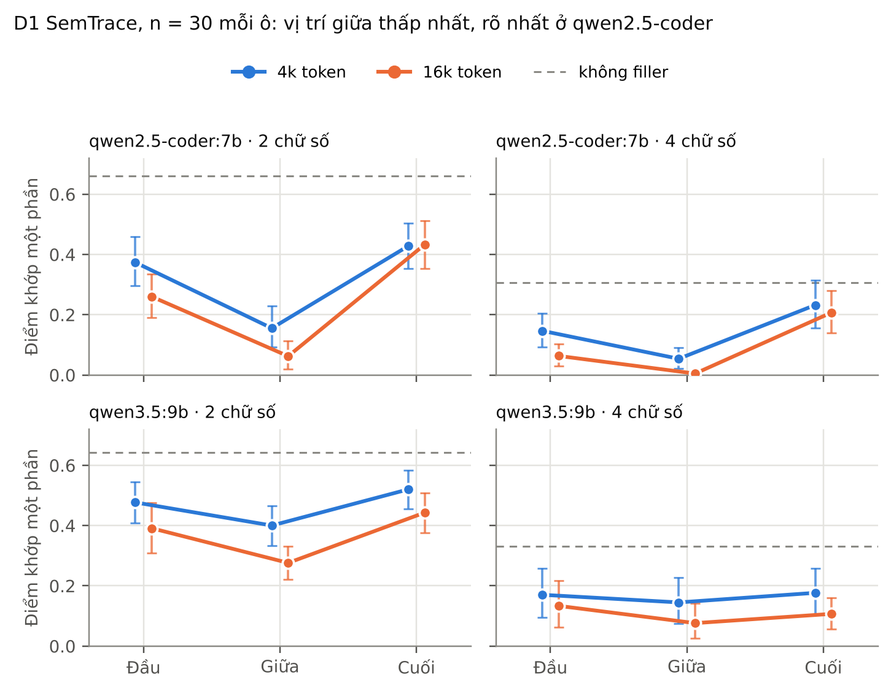

# IT5440 · 5-KH · Báo cáo kết quả chạy mô hình cục bộ

16/11/2026 (bổ sung và hiệu đính 17/11/2026)

## Tóm tắt

Trên dữ liệu tổng hợp, mô hình làm kém hơn rõ rệt khi đoạn mã cần thiết nằm ở giữa ngữ cảnh. Trên code thật (toolz), hiệu ứng này không xuất hiện.

- **D2 SemTrace-Dep, qwen3.5:9b, 50 câu.** Ở 16k token, độ chính xác là 98% ở đầu, 78% ở giữa và 98% ở cuối (p = 0,002; D = +0,20 [0,10; 0,32]). Ở 4k token trên cùng 50 câu thì không có hiệu ứng (96 / 92 / 92%).
- **D2 SemTrace-Dep, qwen2.5-coder:7b, cùng 50 câu.** Mô hình yếu hơn nhiều: không filler đạt 66–70%, nhưng có filler thì chỉ còn 28 / 6 / 6% (đầu / giữa / cuối) ở 4k và 6 / 0 / 0% ở 16k. Ở 4k giữa thấp hơn đầu rõ rệt (13:2, p = 0,007) nhưng ngang cuối, tức là thiên về đầu (primacy) hơn là hình chữ U. Cắt theo call graph (C3) khôi phục lên 62%.
- **D1 SemTrace (filler cố định).** Cả hai mô hình đều thấp nhất ở giữa theo điểm khớp một phần. Mức sụt của qwen2.5-coder:7b (D = +0,13 đến +0,28) lớn gấp khoảng 2,5 lần qwen3.5:9b (D = +0,03 đến +0,14).
- **toolz, code thật.** qwen3.5:9b không sụt ở giữa (D = −0,04). Kết quả này khớp với nghiên cứu S2 của nhóm.

Mọi con số và hình được tính lại từ log thô bằng `analysis/analyze.py` và `analysis/figures.py` trong repo đính kèm.

## 1. Thiết lập

Hai mô hình mở chạy cục bộ qua Ollama trên Apple M2 Pro 16 GB, temperature 0, mỗi lần một truy vấn. Cửa sổ ngữ cảnh là 24.576 token cho D1 và toolz; D2 (`pilot.py` v5) đặt cửa sổ theo độ dài: 8.192 token ở 4k và 23.360 token ở 16k (không prompt nào bị cắt). Thinking của qwen3.5 được tắt qua API gốc của Ollama; đã kiểm tra không có dòng nào chứa thinking.

| Tập dữ liệu | Nội dung | Mô hình | Độ dài | Cách chấm |
| --- | --- | --- | --- | --- |
| D2 SemTrace-Dep (`pilot.py` v5) | Chuỗi 5 hàm tổng hợp, độ sâu 2, suy luận từng bước, tối đa 2048 token ra | qwen3.5:9b, qwen2.5-coder:7b | 4k, 16k; 50 câu | Đúng/sai |
| D1 SemTrace (builder của nhóm) | 30 câu 2 chữ số + 30 câu 4 chữ số, trả lời trực tiếp | qwen2.5-coder:7b, qwen3.5:9b | không filler, 4k, 16k | Khớp một phần |
| toolz (pipeline của nhóm) | 40 câu k=1 + 40 câu k=3, trả lời trực tiếp | qwen2.5-coder:7b, qwen3.5:9b | không filler, 4k | Đúng/sai |

Filler được dựng một lần cho mỗi câu và dùng lại ở mọi vị trí. Script kiểm tra `filler_hash` trùng nhau ở đầu, giữa và cuối, nên chênh lệch chỉ đến từ vị trí.

Chỉ số chính là D = (đầu + cuối)/2 − giữa, tính theo từng câu rồi lấy trung bình. D > 0 nghĩa là vị trí giữa kém hơn hai đầu. Khoảng tin cậy 95% tính bằng bootstrap 10.000 lần. So sánh cặp dùng sign test chính xác (McNemar). D1 chấm khớp một phần (tỉ lệ phần tử đúng trong danh sách đáp án) vì khớp chính xác gần như bằng 0. Điểm khớp một phần được tính lại từ câu trả lời trong log, sau khi bỏ dấu backtick và vỏ `array(...)` bao quanh.

## 2. Kết quả chính: hiệu ứng vị trí ở mọi lần chạy

Hình 1 gom cả 14 lần chạy. 8/14 có khoảng tin cậy nằm hẳn trên 0. Ở 7 lần trong số đó, vị trí giữa thấp hơn cả đầu lẫn cuối. Riêng qwen2.5-coder trên D2 ở 4k, giữa ngang cuối, và D > 0 chỉ do vị trí đầu cao hơn (mục 4). Không lần chạy nào có D âm rõ rệt. Ba quy luật nổi lên:

1. **Độ dài làm hiệu ứng xuất hiện ở mô hình mạnh hơn.** qwen3.5 trên D2 không sụt ở 4k nhưng sụt rõ ở 16k.
2. **Mô hình cũ hơn sụt mạnh hơn, và sụt từ ngữ cảnh ngắn hơn.** Trên D1, qwen2.5-coder có D cao hơn qwen3.5 ở mọi ô. Trên D2, qwen2.5-coder đã có D > 0 ở 4k (D = +0,11), nhưng là do vị trí đầu cao hơn chứ giữa không thấp hơn cuối; ở 16k thì gần như sai hết ở mọi vị trí nên D không còn đo được (+0,03).
3. **Code thật không cho thấy hiệu ứng.** Cả hai khoảng tin cậy của toolz đều chứa 0. qwen2.5-coder có xu hướng sụt (+0,11), nhưng chưa đạt ý nghĩa (cận dưới của CI xấp xỉ 0, p = 0,07).

## 3. D2 SemTrace-Dep: qwen3.5 chỉ sụt ở giữa khi ngữ cảnh dài

| Mô hình | Độ dài (token prompt) | C0 | C1 đầu | C1 giữa | C1 cuối | C2 | C3 | Giữa so với đầu (b:c, p) | Giữa so với cuối (b:c, p) | D [CI 95%] |
| --- | --- | --- | --- | --- | --- | --- | --- | --- | --- | --- |
| qwen3.5:9b | 4k (4.216–4.572) | 100% | 96% | 92% | 92% | 96% | 98% | 3:1, p = 0,63 | 2:2, p = 1,00 | +0,02 [−0,04; +0,09] |
| qwen3.5:9b | 16k (16.636–17.438) | 98% | 98% | 78% | 98% | 98% | 98% | 10:0, p = 0,002 | 10:0, p = 0,002 | +0,20 [+0,10; +0,32] |
| qwen2.5-coder:7b | 4k (3.979–4.357) | 66% | 28% | 6% | 6% | 0% | 62% | 13:2, p = 0,007 | 2:2, p = 1,00 | +0,11 [+0,02; +0,20] |
| qwen2.5-coder:7b | 16k (15.657–16.516) | 70% | 6% | 0% | 0% | 0% | 62% | 3:0, p = 0,25 | 0:0, p = 1,00 | +0,03 [0,00; +0,07] |

Cả hai mô hình chạy trên đúng 50 câu và cùng filler (cùng `filler_hash` từng câu). Phần dưới đây nói về qwen3.5; qwen2.5-coder ở mục 4.

- Ở 16k có 11 câu sai ở giữa. 10 câu trong số đó đúng ở cả đầu lẫn cuối; câu còn lại sai ở cả ba vị trí. Không có câu nào đúng ở giữa mà sai ở đầu hoặc cuối.
- 4 trong 10 câu này là câu trả lời bị cắt ở giới hạn 2048 token, và việc bị cắt chỉ xảy ra ở giữa. Bỏ 4 câu này vẫn còn 6:0, p = 0,031.
- C0, C2 và C3 đều đạt 96–100%, nên mô hình làm được bài. Chuyển khối mã cần thiết ra cuối (C2) hoặc cắt theo call graph (C3) khôi phục độ chính xác từ 78% lên 98%.
- Riêng vị trí giữa, từ 4k lên 16k có 10 câu tệ đi và 3 câu tốt lên (p = 0,09). Xu hướng tăng theo độ dài rõ, nhưng chưa đủ ý nghĩa với 50 câu.

## 4. D2 trên qwen2.5-coder:7b: filler làm hỏng bài ở mọi vị trí

Đây là bản chạy lại pilot P của nhóm bằng `pilot.py` v5 (filler cố định), trên cùng mô hình 7B, ở 4k và 16k (`run_queue4.sh`, 16–17/11).

- **Mô hình làm được bài khi không có nhiễu.** C0 đạt 66% (4k) và 70% (16k); C3, chỉ giữ các hàm trong bao đóng call graph, đạt 62% ở cả hai độ dài.
- **Có filler thì độ chính xác sụp ở mọi vị trí.** Ở 4k: 28% ở đầu, 6% ở giữa, 6% ở cuối. Ở 16k: 6 / 0 / 0%. C2 (khối mã cần thiết liền nhau ở cuối) đạt 0% ở cả hai độ dài.
- **Dạng hiệu ứng là primacy, không phải chữ U.** Ở 4k, giữa thấp hơn đầu rõ rệt (13:2, p = 0,007) nhưng ngang cuối (2:2). D = +0,11 [+0,02; +0,20] có ý nghĩa chủ yếu nhờ vị trí đầu. Ở 16k mọi vị trí gần 0 nên D = +0,03 không còn đo được hiệu ứng (hiệu ứng sàn).
- **Câu trả lời bị cắt nhiều hơn hẳn qwen3.5.** Số câu chạm giới hạn 2048 token (trên 50): ở 4k là 4 / 6 / 8 (đầu / giữa / cuối) và 15 ở C2; ở 16k là 14 / 9 / 9 và 15 ở C2. qwen3.5 chỉ có 4 câu bị cắt ở mỗi độ dài (ở 16k đều ở giữa). Ở 16k vị trí đầu bị cắt nhiều nhất, nên điểm 6% ở đầu cũng bị giới hạn này kéo xuống. Mô hình thường suy luận lan man đến hết ngân sách.
- **So với qwen3.5 trên cùng 50 câu:** mô hình mới hơn giữ 92–98% ở mọi vị trí tại 4k, còn qwen2.5-coder mất gần hết. Với suy luận từng bước, mô hình 7B mất cả vị trí cuối, không chỉ vị trí giữa.

## 5. D1 SemTrace: vị trí giữa thấp nhất, rõ nhất ở qwen2.5-coder

- **qwen2.5-coder:7b** có dạng chữ V rõ. Ở 16k, 2 chữ số: đầu 0,26, giữa 0,06, cuối 0,43. Khi không có filler, điểm là 0,66, nên filler làm giảm điểm ở mọi vị trí, nặng nhất ở giữa. Vị trí cuối vẫn cao hơn vị trí đầu (0,43 so với 0,26), tức mô hình ưu tiên đoạn mã gần câu hỏi hơn (recency).
- **qwen3.5:9b** chỉ sụt nhẹ ở giữa (D ≈ +0,10 đến +0,14 với 2 chữ số). Ở 16k, điểm thấp hơn 4k ở mọi vị trí, không riêng ở giữa.
- Bài 4 chữ số khó đến mức gần sàn với qwen3.5 (0,08–0,18), nên không thấy hiệu ứng rõ.
- Bài chép lại nguyên văn đoạn mã ở vị trí giữa đạt 100% (qwen2.5-coder, 120 lượt). Mô hình tìm thấy đoạn mã nhưng truy vết sai, nên vấn đề nằm ở khâu sử dụng, không phải khâu truy xuất.

## 6. toolz: code thật không có hiệu ứng vị trí ở 4k

| Mô hình | Không filler k=1 | Không filler k=3 | 4k k=1 đầu / giữa / cuối | Giữa so với đầu (b:c, p) | 4k k=3 cụm đầu / giữa / cuối / rải |
| --- | --- | --- | --- | --- | --- |
| qwen2.5-coder:7b | 52,5% | 20% | 52,5% / 37,5% / 45% | 7:1, p = 0,07 | 30% / 37,5% / 35% / 32,5% |
| qwen3.5:9b | 50% | 30% | 37,5% / 42,5% / 40% | 2:4, p = 0,69 | 30% / 22,5% / 22,5% / 20% |

Mỗi ô có 40 câu. qwen3.5 không sụt ở giữa. qwen2.5-coder có xu hướng giữa thấp hơn đầu (p = 0,07), nhưng chưa đạt ý nghĩa. Với k=3, dồn hay rải các đoạn mã cần thiết không tạo khác biệt rõ ở cả hai mô hình.

## 7. Hạn chế và việc còn lại

- Cỡ mẫu nhỏ: n = 50 ở D2, 30–40 ở D1 và toolz. So sánh 4k với 16k (p = 0,09) chưa đủ ý nghĩa.
- Chỉ có hai mô hình nhỏ, lượng tử hóa 4-bit, một lần chạy với temperature 0 và một filler seed. toolz cục bộ chỉ chạy đến 4k.
- Ở D2 16k, 4 câu trả lời ở giữa của qwen3.5 bị cắt ở 2048 token. Đây có thể cũng là một biểu hiện của hiệu ứng: mô hình suy luận lan man hơn khi đoạn mã cần thiết nằm ở giữa. Với qwen2.5-coder, việc bị cắt xảy ra ở mọi vị trí và ở C2, nên giới hạn 2048 token có thể làm thấp điểm của mô hình này.
- D1 gần mức sàn khi chấm chính xác, nên kết luận về D1 dựa trên điểm khớp một phần.
- Việc còn lại: chạy lại D1 với filler đã sửa trên DeepSeek-V4-Flash và Qwen3.6-27B (cần API key của nhóm). Pilot P đã được chạy lại bằng v5 trên qwen2.5-coder:7b (mục 4).

## Tái lập

Repo `it5440-5kh-local-runs` chứa code, hàng đợi chạy qua đêm, log và toàn bộ kết quả thô. Chạy `python3 analysis/analyze.py` để tính lại các bảng và `python3 analysis/figures.py` để vẽ lại các hình (cần matplotlib). Chi tiết có trong `README.md`.

**Hiệu đính 16/11/2026.** Bản trước ghi điểm không filler của qwen2.5-coder trên D1 là 0,25 (2 chữ số) và 0,24 (4 chữ số). Lý do: hàm `partial()` không bỏ dấu backtick, nên 26/60 câu trả lời được chấm 0. Giá trị đúng là 0,66 và 0,31. Hàm đã được sửa và hai script phân tích tính lại điểm từ log thô. Các giá trị theo vị trí và D không đổi. Bản này cũng sửa một số câu chữ (số câu sai ở giữa tại 16k, tỉ lệ 3–4 lần, cửa sổ ngữ cảnh của D2, D ≥ 0) và ghi tỉ lệ toolz đến 0,5%.

**Bổ sung 17/11/2026.** Thêm D2 trên qwen2.5-coder:7b (mục 4; bảng và Hình 2 có cả hai mô hình; Hình 1 có 14 lần chạy). Log: `pilot/results/q25c_*.jsonl`, `logs/queue4/`.

**Hiệu đính 17/11/2026 (chấm điểm).** Kiểm tra độc lập toàn bộ số liệu từ log thô. D2 của cả hai mô hình đúng (C0 của qwen2.5-coder ở 16k là 70%, tức 35/50). Có hai lỗi đọc câu trả lời đã được sửa. (1) D1, qwen3.5: 19 câu trả lời bọc danh sách trong `array(...)` kiểu numpy hoặc lặp `ANSWER:` bị chấm 0, phần lớn ở vị trí đầu và khi không có filler. Sau khi chấm danh sách bên trong: không filler 2 chữ số 0,51 → 0,64; 2 chữ số 4k đầu 0,45 → 0,48, D +0,09 → +0,10; 2 chữ số 16k đầu / cuối 0,33 / 0,42 → 0,39 / 0,44, D +0,10 → +0,14. Khớp chính xác không đổi. (2) toolz, qwen3.5: một câu trả lời đúng có dạng `ANSWER: ANSWER: [...]` bị chấm sai. Giữa 40% → 42,5%, D −0,01 → −0,04. Số lần chạy có ý nghĩa vẫn là 8/14. Bản này cũng sửa câu chữ ở mục 2 và tiêu đề mục 4 (vị trí đầu cũng sụt) và ghi đủ số câu bị cắt theo vị trí.
